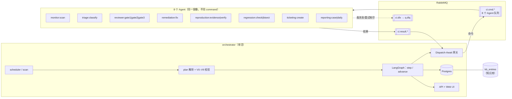
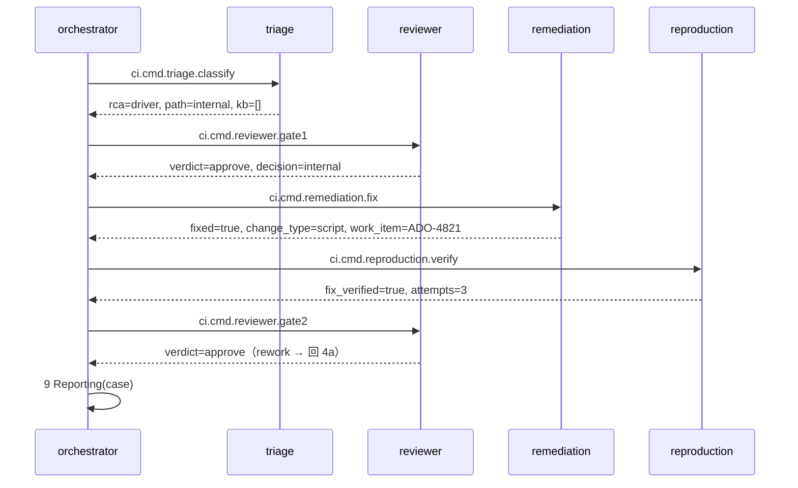
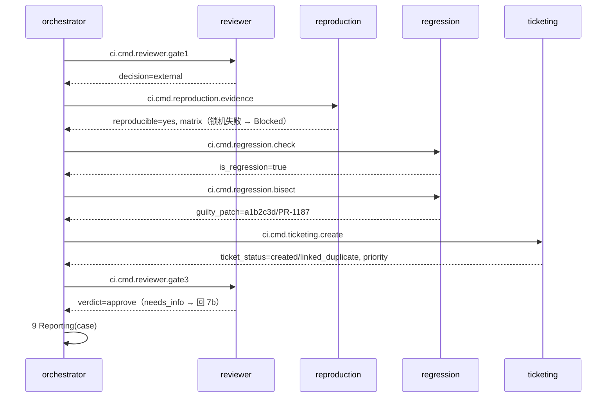
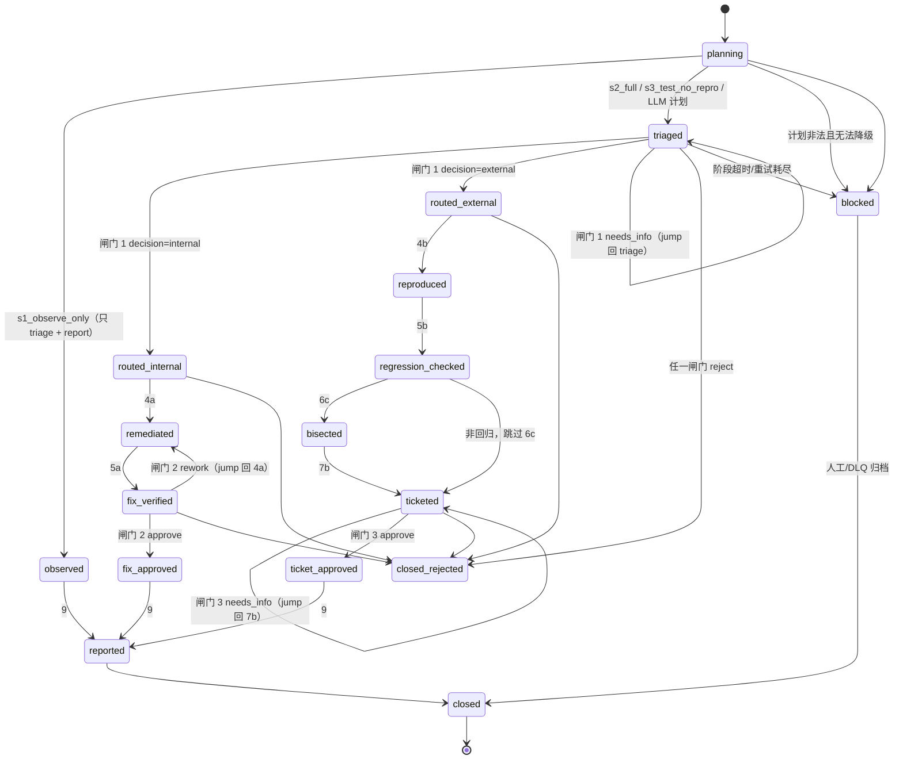

# 01 · 架构总览

## 1. 组件拓扑

编排层是唯一的下游决定者；Agent 只回结论词（`internal` / `approve` / `regression` / `needs_info` …），
由计划里的 `on.<verb>` 决定下一步。

## 2. internal 分支（4a–6a）

## 3. external 分支（4b–8b）

非回归（`is_regression=false`）时 5b 直接前向 7b，跳过 6c；测试类失败（`test:*`）跳过 4b。

## 4. 编排来源：预定义 workflow 优先，LLM 兜底

| 优先级 | 来源 | 何时使用 | 产物 |
|---|---|---|---|
| 1 | 预定义 workflow | 触发信息命中 `workflows/*.yaml` 的 `match` | `plans/<case_id>/*.yaml`（`source=workflow`） |
| 2 | LLM 兜底 | registry 未命中（如 `llm-plan-demo/*`） | 同 schema 的 YAML（`source=llm`），两次不合法 → degraded 安全网 |

内置三份：`s1_observe_only`（`signal=none`）、`s2_full`（`signal=error`，双分支）、
`s3_test_no_repro`（签名族 `test:*`，跳过 4b）。

## 5. Case 状态机

状态由四样东西驱动：计划里的 `on.<verb>.set_status`、闸门结论、step 超时/重试耗尽（blocked）、
以及 `jump` 回炉（状态回到被跳回的那一步之前）。

## 6. 设计原则

1. **确定性执行 + 显式计划**：走哪几步由落盘的计划决定；图结构与执行器固定，分支/回炉由纯函数按计划判定。
2. **总线是唯一通信面**：跨单元调用只有 pub/sub；Agent 无业务 HTTP，编排层无 Agent 直连。
3. **At-least-once + 幂等**：命令带幂等键，Agent 与编排层各有一层去重；重复投递不会重复建单。
4. **一处状态源**：Case、step 执行、证据、复核、修复、验证、回归、工单、日报、知识库全部落 Postgres。
5. **写权分离**：Agent 只写证据，业务表由编排层收结果后写，口径唯一。
6. **Mock 可替换**：输入/输出契约与 Mock 实现分离，替换内部逻辑不改编排与总线。
7. **全程可回溯**：`GET /api/cases/{id}/trace` 能看到「哪条命令、哪个 mode、第几次、返回什么」。
8. **约束下沉到 broker**：只有编排层对 `ci.cmd` 有 write 权限（02 §9），不是代码自觉。
9. **计划即文件**：人工 `workflows/*.yaml` 与 LLM `plans/*.yaml` 同构、同校验器、同执行器。

## 7. 规模与配额（演示档）

| 项 | 演示配置 | 说明 |
|---|---|---|
| Monitor 扫描周期 | `MONITOR_SCAN_INTERVAL_S=3600` | 演示按小时；可用 API 手动触发 |
| 每阶段超时 | `STAGE_TIMEOUT_S=30` | 超时 → retryable → 重试耗尽 → blocked |
| 每阶段最大尝试 | `STAGE_MAX_ATTEMPTS=2` | `attempt` 在 Case 生命周期内单调递增 |
| 闸门回炉上限 | `MAX_REVIEW_LOOPS=2` | 超过则 reject(loop_exhausted) |
| 计划步数上限 | `MAX_PLAN_STEPS=24` | 完整计划 11 步，留回炉与观测余量 |
| 图递归上限 | `RECURSION_LIMIT=40` | 防回炉死循环 |
| 并发在飞 Case | `MAX_INFLIGHT_CASES=4` | 网关 Futures 与引擎并发 |
| 链路 TAT | ≤ 90 s（Mock） | 真实场景另定 |
