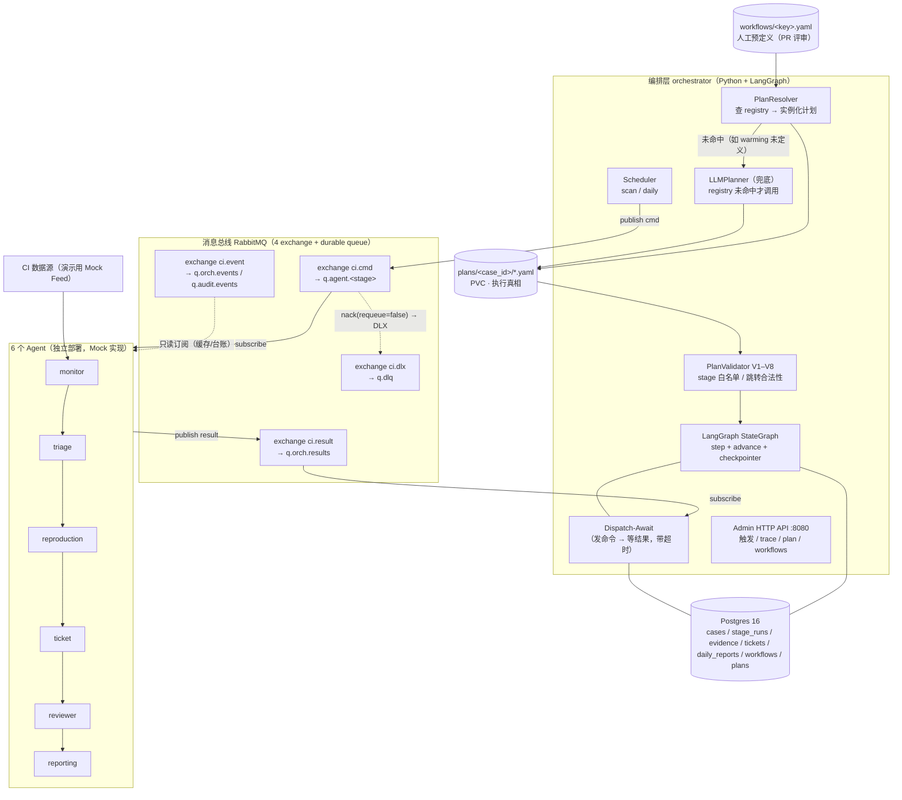
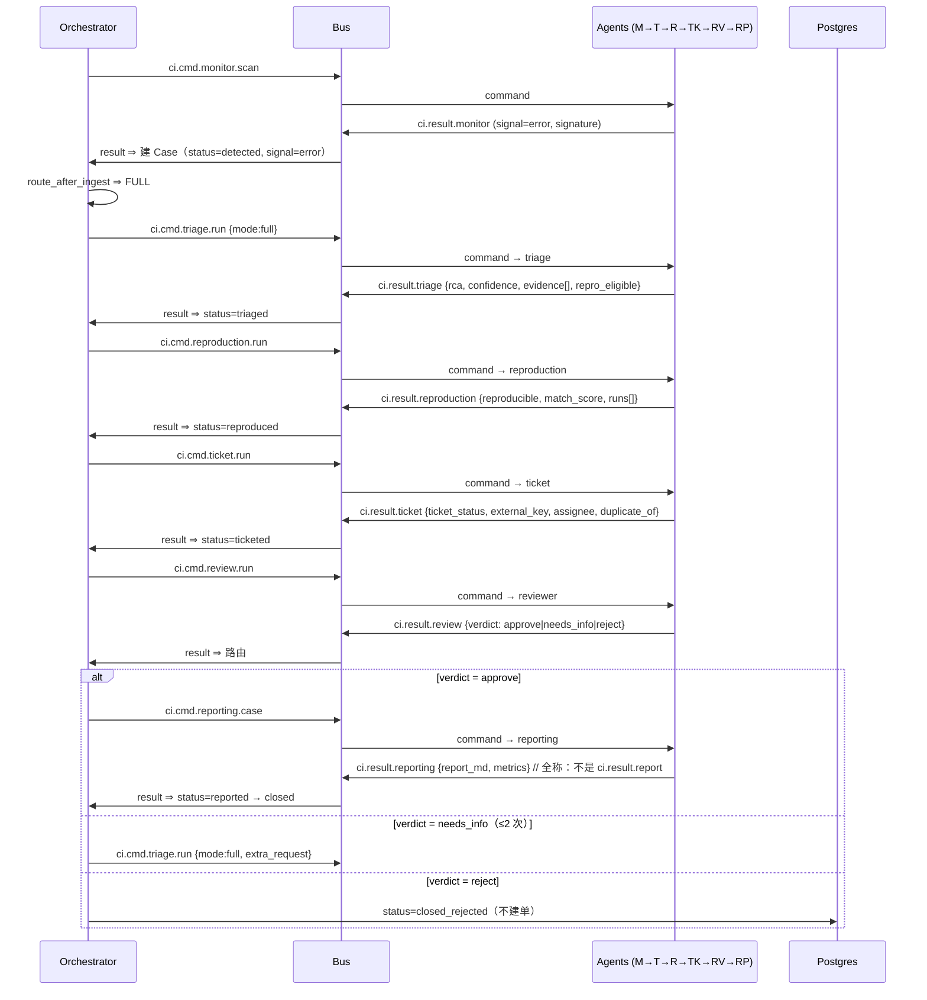
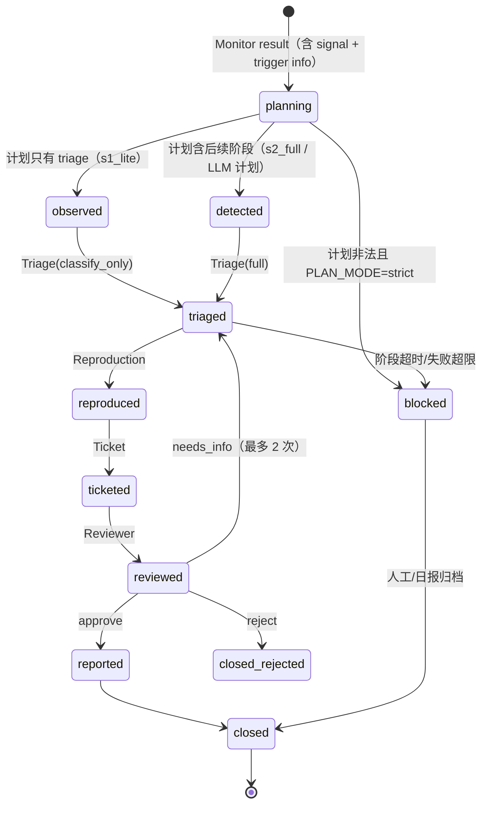

# 01 架构总览

## 1. 组件拓扑



要点：
- **只有编排层发布 command**（含定时触发的 scan / daily）；Agent 只订阅自己的队列 `q.agent.<stage>`（绑定 `ci.cmd.<stage>.<action>`，如 `ci.cmd.triage.run`）。
- **Agent 只发布 result**（`ci.result.<stage>`）和可选的领域事件；不直接命令其他 Agent。
- 编排层是唯一持有 Case 状态与路由决策的地方，Postgres 是唯一事实源。
- **走哪些阶段由一份 plan YAML 决定**：命中 `workflows/*.yaml`（人工预定义）就用它实例化，未命中才让 LLM 写一份同构的 plan；执行器只读文件，不读模型。
- **命令 `payload.mode` 的取值以 `orchestrator/src/iqe_orchestrator/common/data/schemas/stage-contracts.json` 为权威**：`monitor=scan`、`triage=full|classify_only`、`reproduction/ticket/review=run`、`reporting=case|daily`；`plan.schema.json` 与执行器只认这组值。

---

## 2. 场景 S1：Monitor 消息不含报错（只走 Monitor → Triage）

```mermaid
sequenceDiagram
  participant O as Orchestrator
  participant B as RabbitMQ
  participant M as agent-monitor
  participant T as agent-triage
  participant D as Postgres

  O->>B: publish ci.cmd.monitor.scan (run_id=R1)
  B->>M: deliver command
  M->>M: 读 Mock Feed → 观测列表（全部 signal=none）
  M->>B: publish ci.result.monitor {observations:[...]}
  B->>O: deliver result
  O->>D: insert cases(status=detected)
  O->>O: route_after_ingest → signal=none ⇒ LITE
  O->>B: publish ci.cmd.triage.run {mode:classify_only}
  B->>T: deliver command
  T->>B: publish ci.result.triage {category, noise_score, signature}
  B->>O: deliver result
  O->>D: stage_runs(monitor scan attempt=1 · case_id NULL; triage=done), cases.status=triaged
  O->>O: END（不创建工单、不进 Reporting 链路）
```

结果：Case 停在 `triaged`，只留下分类与噪声标签；不生成工单、不进入日报正文（仅计入「观测计数」）。

---

## 3. 场景 S2：Monitor 消息含报错（完整串行 6 个 Agent）



---

## 4. 编排来源：预定义 workflow 优先，LLM 兜底（S3：未定义流程）

| 来源 | `plan_source` | 判定 | 产物（结构完全同构） |
|---|---|---|---|
| **预定义 workflow**（含人工新增） | `workflow` | 触发 info 命中 registry（显式 `workflow_key`，或 `signal` 等 `match` 规则） | `workflows/<key>.yaml` 实例化为 `plans/<case_id>/<plan>.yaml` |
| **LLM 自主编排**（兜底） | `llm` | registry **未命中**（如触发方声明 `workflow_key=warming`，但 `workflows/warming.yaml` 不存在） | 模型直接写 `plans/<case_id>/<plan>.yaml`（同一 schema） |

四条不变式：
1. **先查定义，后问模型**：只要能命中已发布 workflow，就绝不调用 LLM（D8 判据：`ci_llm_plan_calls_total` 不增加）。
2. **产物同构**：两种来源都落成 YAML 文件，过同一个 validator（03 §6 V1–V8），由同一个执行器（`step`/`advance`）消费。
3. **人工参与 = 写 workflow**：人在 `workflows/*.yaml` 里加流程并走 PR 评审，不 runtime 拼单条 Case 的路径。
4. **执行期零模型调用**：崩溃恢复与重放都读已落盘的 plan YAML，不重新生成。

```mermaid
sequenceDiagram
  participant T as Trigger（带 info）
  participant O as PlanResolver
  participant WF as workflows/*.yaml
  participant L as LLMPlanner
  participant P as plans/&lt;case&gt;/*.yaml
  participant X as Executor

  T->>O: workflow_key=warming
  O->>WF: 查 warming
  WF-->>O: 未命中
  O->>L: 生成计划（stage 能力表 + 观测摘要）
  L->>P: 写 plan.yaml（source=llm）
  O->>X: yaml.safe_load → Validator V1–V8
  X-->>O: 通过 → step/advance 确定性执行
  Note over O,WF: 之后人工补上 workflows/warming.yaml<br/>同一触发改走 source=workflow，不再调用 LLM
```

---

## 5. Case 状态机



> S1 路径的终态是 `triaged`（或 `observed→triaged`），不进入 `reproduced` 及其后的状态。
> `planning` 是新增的入口态：无论来源是 workflow 还是 LLM，Case 都必须先拿到一份通过校验的 plan 才进入执行态。

---

## 6. 设计原则

1. **确定性执行 + 显式计划**：走哪几步由一份落盘的 plan YAML 决定（来源记在 `plan_source`）。图结构与执行器固定（`step`/`advance`），分支、循环、重试、终止仍由纯 Python 函数按计划判定；Agent 只输出结构化结论，不能指定下游 Agent。
2. **总线是唯一通信面**：跨单元调用只有 pub/sub；Agent 无 HTTP 业务接口，编排层无 Agent 直连。
3. **At-least-once + 幂等**：所有命令消息带幂等键，Agent 与编排层各有一层去重；重复投递不会导致重复建单或重复开单。
4. **一处状态源**：Case 状态、阶段执行记录、证据、工单、日报全部落 Postgres；总线消息只是「推进信号」。
5. **Mock 可替换**：Agent 契约（输入/输出 schema）与 Mock 实现分离；把 Mock 换成真实取证时，编排层与总线契约不变。
6. **全程可回溯**：任一 Case 可用 `GET /api/cases/{id}/trace` 回放「哪条命令、哪个 Agent、第几次尝试、返回了什么」。
7. **约束下沉到 broker**：只有编排层对 `ci.cmd` 有 write 权限，"Agent 不得私发命令"由 RabbitMQ 权限强制，而非代码自觉（见 02 §9）。
8. **计划即文件，人工与模型同一入口**：人工在 `workflows/*.yaml` 加流程（PR 评审），LLM 兜底时写 `plans/<case_id>/*.yaml`；两者结构同构、过同一 validator、由同一执行器消费。执行期不再调用模型（见 03 §2）。

---

## 7. 规模与配额（演示档）

| 项 | 演示配置 | 说明 |
|---|---|---|
| Monitor 扫描周期 | 5 min | `MONITOR_SCAN_INTERVAL_S=300` |
| 单次扫描 Mock 构建数 | 10 | Mock Feed |
| 单 Case 全链路目标 TAT | ≤ 90 s（Mock 延迟） | 真实场景另定 |
| 每阶段超时 | 30 s | `STAGE_TIMEOUT_S=30` |
| 每阶段最大尝试 | 2 | `STAGE_MAX_ATTEMPTS=2`（只是**单次访问**的重试窗口；`attempt` 在 Case 生命周期内单调递增，见 03 §8） |
| Reviewer 回退次数上限 | 2 | `MAX_REVIEW_LOOPS=2` |
| LangGraph recursion_limit | 14 | 防死循环 |
| 计划步数上限 | 8 | `MAX_PLAN_STEPS`（validator V1） |
| 计划生成超时 | 8 s | `PLAN_TIMEOUT_S`，超时即走安全网 |
| 单计划文件上限 | 8 KB | `PLAN_MAX_BYTES`（防模型灌水） |
| 并发在飞 Case | 4 | `MAX_INFLIGHT_CASES=4` |
