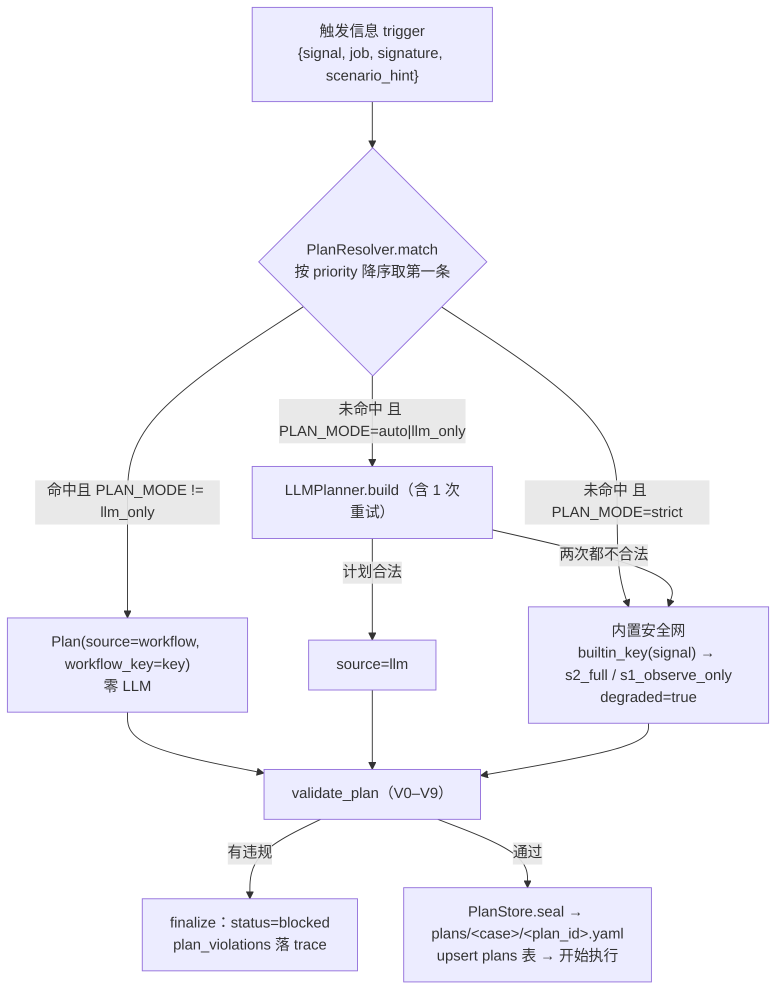

# 03 编排层设计（Python + LangGraph）

## 1. 职责边界

**做**：定时触发 Monitor / Reporting；接收扫描结果并建 Case；**解析计划来源（workflow 注册表优先，LLM 兜底）**；
按计划逐步投递命令到总线；等待结果、推进 step、分支与回炉；超时重试、回炉上限、终态收敛；
写业务表与审计；对外提供 HTTP API 与 Web UI。

**不做**：任何分类、复核、修复、复现、回归判定、建单、成文逻辑（全部在 Agent 内）；
不在运行时"临时拼路径"——人工参与编排的唯一方式是新增/修改 `common/data/workflows/*.yaml`。

进程构成（一个容器，`ci-orchestrator`）：

```
orchestrator
 ├── Scheduler        : 定时 publish ci.cmd.monitor.scan（扫描）/ ci.cmd.reporting.daily（日报）
 ├── ScanRunner       : 等 Monitor 结果 → 抑制噪声 → 每个 signal=error 的观测起一张计划图
 ├── PlanResolver     : 触发信息 → 查 workflow registry → 命中则实例化为 plan
 ├── LLMPlanner       : registry 未命中 → 让模型写同构 plan（失败重试 1 次 → 内置安全网）
 ├── PlanStore        : plans/<case_id>/<plan_id>.yaml（封存 + sha256）；执行器只从这里加载
 ├── validate_plan    : V0–V9 纯函数校验（schema / 白名单 / 形状 / 路由 / 循环 / 防注入 / 闭合）
 ├── CaseEngine       : StateGraph(resolve_plan → validate_plan → step → advance → finalize)
 ├── BusGateway       : Dispatch–Await：唯一的总线写者，按 idempotency_key 配对 in-process Future
 └── FastAPI app      : /healthz /readyz /metrics + /api/* + Web UI（/、/ui/*）
```

三条不变量：

1. **执行期零模型调用**：分支、回炉、终态都在计划文件里写好；崩溃恢复、重放都不再问模型。
2. **编排层是唯一的下游决定者**：Agent 之间不互相调用，也不直连编排层，跨单元通信只走 RabbitMQ。
3. **step 输出按 `step_id` 存放**：reviewer 在同一张计划里跑三道闸门（gate1/gate2/gate3），按 stage 存会互相覆盖。

---

## 2. 计划层：workflow 优先，LLM 兜底

### 2.1 两级来源（不存在第三级）

| 来源 | `plan_source` | 触发条件 | 谁写计划 | 是否调 LLM |
|---|---|---|---|---|
| **预定义 workflow** | `workflow` | 命中 registry 的 `match` 规则 | 人工写 `common/data/workflows/<key>.yaml`，PR 评审后发布 | 否 |
| **LLM 自主编排** | `llm` | registry 未命中 | 模型写同构 YAML，落到同一目录 | 是（仅一次，含 1 次重试） |

两级来源的产物**完全同构**：一个 plan 文档。「人工编排 = 人工预定义 workflow」，
人在运行时不为单个 Case 拼路径，这样"人参与编排"与"执行确定性"不冲突。

### 2.2 命中判定（唯一入口 `CaseEngine._resolve_plan`）



`match` 支持的字段（`Workflow.load` + `PlanResolver.match`）：

| 字段 | 语义 |
|---|---|
| `signal` | 精确匹配 `none` / `error` |
| `job_pattern` / `job_not_pattern` | 对 job 名做 `re.search` |
| `signature_family_prefix` | 签名族前缀，如 `test:` |

命中多条时按 `(-priority, key)` 排序取第一条，因此"更具体的规则"给更高 `priority`。

### 2.3 三份内置 workflow

| key | priority | 命中条件 | 形状 |
|---|---|---|---|
| `s1_observe_only` | 100 | `signal=none` | `triage:classify → reporting:case`（只观测，不建链路） |
| `s2_full` | 100 | `signal=error` 且 job 不匹配 `llm-plan-demo` | 11 步完整双分支（见下） |
| `s3_test_no_repro` | 150 | `signal=error` 且签名族 `test:` | external 分支跳过 4b：`gate1 → regression:check → …` |

`s2_full` 的 step 与路由（`common/data/workflows/s2_full.yaml`）：

| step | stage:mode | 路由（`on`） |
|---|---|---|
| `t1` | triage:classify | 顺序 → `g1` |
| `g1` | reviewer:gate1 | `internal → r1` / `external → e1` / `needs_info → jump t1` / `reject → end`；另带 `approve → r1`（兼容历史结论词，闸门 1 正常只判分流） |
| `r1` | remediation:fix | 顺序 → `v1` |
| `v1` | reproduction:verify | 顺序 → `g2` |
| `g2` | reviewer:gate2 | `approve → p1` / `rework → jump r1` / `reject → end` |
| `e1` | reproduction:evidence | 顺序 → `c1` |
| `c1` | regression:check | `regression → b1` / `not_regression → k1` |
| `b1` | regression:bisect | 顺序 → `k1` |
| `k1` | ticketing:create | 顺序 → `g3` |
| `g3` | reviewer:gate3 | `approve → p1` / `needs_info → jump k1` / `reject → end` |
| `p1` | reporting:case | 终点（`advance` 走到计划末尾 → `closed`） |

> 每个 step 可写 `timeout_s` 覆盖 `STAGE_TIMEOUT_S`（闸门 20s、修复/复现 60s），也可写 `max_attempts` 覆盖 `STAGE_MAX_ATTEMPTS`。

`s3_test_no_repro` 与 `s2_full` 的唯一差别是 `g1.external → c1`（测试类失败不占重跑机位，
取证合并进 5b），因此 `reproduction:evidence` 这一步在该计划里不存在。

> `builtin_plan()` 是**降级安全网**，与 registry 里的同名 key 不是同一份内容：
> 它只保证"能跑完一条最小可信链路"，并在 `plans.degraded=true` 上留痕。

### 2.4 统一流水线

```
           ┌──── 人工：common/data/workflows/<key>.yaml ──┐
触发 info ─┤                                              ├─→ [实例化] ─┐
           └──── LLM：模型写 steps ───────────────────────┘             ▼
                                                       yaml.safe_load → Plan
                                                                      ▼
                                                          validate_plan（V0–V9）
                                                                      ▼
                                    PlanStore.seal（落盘 + sha256 + plans 表索引）
                                                                      ▼
                             CaseEngine：按 cursor 逐步 dispatch，next / jump / end 由计划决定
```

**为什么统一成 YAML**：① 人和模型写同一种东西，评审/回放看的也是同一种东西；
② 校验器只实现一遍，人工计划不享受"信任特权"；③ 执行器只吃文件，崩溃恢复与重放都不需要模型。

---

## 3. 图定义（计划驱动，两步循环）

```python
# orchestrator/src/iqe_orchestrator/graph.py
START → resolve_plan ─┬─(有 plan_violations)→ finalize → END
                      └→ validate_plan ─┬─(有 plan_violations)→ finalize
                                        └→ step → advance ─┬─(terminated)→ finalize → END
                                                           └→ step（下一轮）
```

* `step`：执行**一个** step（内部完成"发命令 → 等结果 → 超时/重试/blocked → 落库/写证据"）。
* `advance`：按 `on.<verb>` 决定 `next` / `jump` / `end` / 顺序下一步；回炉在这里清空下游输出。
* 编译时挂 `AsyncPostgresSaver`，`thread_id = case_id`；崩溃重启后 `_run(resume=True)` 从检查点续跑。

---

## 4. State schema（`CaseState`）

| 字段 | 说明 |
|---|---|
| `case_id` `run_id` `scan_id` | 主键与溯源；`scan_id` 只对扫描派生的 Case 有值 |
| `job` `build` `signal` `signature` `payload` | 触发信息与 Monitor 观测（triage 的输入来源） |
| `plan` `plan_id` `plan_source` `workflow_key` `degraded` | 封存的计划与来源 |
| `plan_violations` | 非空即拒绝执行，`finalize` 落 `blocked` |
| `cursor` | 当前 step 下标 |
| `step_status` | `{step_id: done|blocked}` |
| `attempts` | `{step_id: 累计尝试次数}`，**Case 生命周期内单调递增**（保证幂等键唯一） |
| `outputs` | `{step_id: 该步输出}` —— 按 step_id 存，三道闸门互不覆盖 |
| `completed` | 成功过的 step_id 执行序（`_latest()` 用它取"某 stage 最近一次输出"） |
| `loops` | `{step_id:verb: 已用回炉次数}` |
| `review_loop_seq` / `jump_count` | 回炉总次数（也会传给闸门做 `loop_seq`） |
| `requested_focus` | 闸门要求补充的信息，回炉时透传给上游 Agent |
| `pending_verb` / `pending_route` | `step` 与 `advance` 之间的交接（verb 与命中的 `on` 分支） |
| `status` | 活状态（`triaged` / `remediated` / `fix_verified` / … / `closed`） |
| `terminated` `blocked_reason` | 终止标志与原因 |
| `evidence_count` `trace` `gen` | 证据条数、`{at,event}` 轨迹、重放代数 |

所有字段都写进检查点，并在每次 `_persist()` 时投影到 `cases.progress`（JSONB），
Web UI 的"计划 / 实时进度"直接读投影，不去扫检查点。

---

## 5. 路由与推进（纯函数）

### 5.1 Agent 输出 → 路由动词（`_verb_for`）

| stage:mode | 输出的什么字段 | verb |
|---|---|---|
| `reviewer:gate1` | `verdict=approve` 时取 `decision` | `internal` / `external` |
| `reviewer:gate1` | 其它 `verdict` | `needs_info` / `reject` |
| `reviewer:gate2` | `verdict` | `approve` / `rework` / `reject` |
| `reviewer:gate3` | `verdict` | `approve` / `needs_info` / `reject` |
| `regression:check` | `is_regression` | `regression` / `not_regression` |
| 其余所有 stage | —— | `done` |

### 5.2 计划怎么写路由（`_route_for`）

```
step.on 为空                    → {}（顺序执行下一步）
verb 命中 on[verb]              → 该分支
verb 未命中但写了 on.done       → on.done
verb 未命中且没有 on.done       → None → 判 blocked（"计划没写这个出口"）
```

### 5.3 `advance` 的三种跳转

| 路由 | 语义 | 副作用 |
|---|---|---|
| `next: <step_id>` | 前向分支（闸门 1 双分支、非回归跳过 6c） | `cursor` 指向目标；目标必须更靠后（V5 强制） |
| `jump: <step_id>` | 回炉（gate1 `needs_info`、gate2 `rework`、gate3 `needs_info`） | 目标必须更早；**清空目标及其之后所有 step 的 `outputs` / `step_status` / `completed`**；`loops` 计数 +1；超过 `max_loops` → `blocked` |
| `end: true` | 终止（`reject`） | 终态 `closed_rejected` |

* 回炉时从**触发跳转的那一步输出**里取 `requested_info` 写进 `requested_focus`，上游 Agent 的输入会带上它。
* 只有真正发生的跳转才计数（预算用尽时既不跳也不加计数）。
* 回炉后 `attempts` **不重置**：同一 step 再次进入时用更大的 attempt，幂等键天然不同（下游据此区分"重跑"）。

### 5.4 状态推进（`STATUS_AFTER`）

| step | 成功后 Case 状态 |
|---|---|
| `triage:classify` | `triaged` |
| `reviewer:gate1` | `triaged`（真实路径写进 `set_status`：`routed_internal` / `routed_external`） |
| `remediation:fix` | `remediated` |
| `reproduction:verify` | `fix_verified` |
| `reviewer:gate2` | `fix_approved` |
| `reproduction:evidence` | `reproduced` |
| `regression:check` | `regression_checked` |
| `regression:bisect` | `bisected` |
| `ticketing:create` | `ticketed` |
| `reviewer:gate3` | `ticket_approved` |
| `reporting:case\|daily` | `reported` |

路由里的 `set_status` 优先于上表。`finalize` 做终态收敛：
`blocked` / `closed_rejected` 原样保留，**其它一切活状态折叠为 `closed`**（最后活状态记在 `terminal_from`），
并发布 `ci.event.case.<status>`。

---

## 6. 计划校验器（唯一的计划闸门）

`validate_plan(plan_dict, *, max_steps=None) -> list[str]`，返回空列表才算合法。
JSON Schema 打底，再接 V1–V9 语义规则；**人工计划与 LLM 计划同等对待**。

| 编号 | 检查 | 典型拒绝文案 |
|---|---|---|
| V0 | `plan.schema.json` | `V0 schema: 'steps' is a required property` |
| V1 | 步数在 `[1, MAX_PLAN_STEPS]`（默认 24） | `V1 steps 数量 11 不在 [1,24]` |
| V2 | stage 白名单（`monitor` 只能由 Scheduler 触发，不得进计划） | `V2 monitor 只能由 Scheduler 触发…` |
| V3 | mode 必须属于该 stage（`MODE_AUTHORITY`） | `V3 stage=reviewer 的 mode 只能是 ['gate1','gate2','gate3']…` |
| V4 | 主线形状：error 计划以 triage 开头、必须含 gate1；gate2/3 在 gate1 之后；verify 在 fix 之后；bisect 在 check 之后；create 在 check 之后；`reporting:case` 唯一且最后 | `V4 闸门 3 必须在闸门 1 之后` |
| V5 | 路由：动词白名单、`jump` 只能后向、`next` 只能前向、`jump` 不得再带 `next/end`、`next/end` 二选一、`set_status` 合法 | `V5 next 只能前向: g1 -> t1（回炉请用 jump）` |
| V6 | `max_loops` ≤ `MAX_REVIEW_LOOPS`（默认 2） | `V6 max_loops=3 超过上限 2` |
| V7 | step id 唯一且匹配 `STEP_ID` 正则 | `V7 step id 重复` |
| V8 | 防注入：`rationale` / `model` / step 字段不得出现总线 subject、队列名、URL、命令字面量 | `V8 计划文本含被禁止的内容…` |
| V9 | 分支闭合：gate1 必须有 `internal`+`external`；gate2/gate3 必须有 `approve`；`regression:check` 必须有 `regression`+`not_regression` | `V9 step=g1（gate1）必须同时给出 internal 与 external 路由` |

路由动词白名单：`internal` `external` `approve` `rework` `needs_info` `reject` `regression` `not_regression` `done` `blocked`；
其中只有 `needs_info` / `rework` 允许用 `jump`。

> V9 是"计划能不能跑完"的关键：漏一个出口，执行期就会在 `_route_for` 拿到 `None` 而 `blocked`。
> 与其让 Case 卡在半夜，不如在封存前拒掉。

---

## 7. LLMPlanner

```python
prompt = PLAN_PROMPT.format(max_steps=cfg.max_plan_steps, ctx=case_ctx[:cfg.plan_ctx_chars])
for attempt in (1, 2):
    raw = load_plan_fixture(...)      # MOCK_LLM_ENABLED=true / 无 endpoint 时读夹具
    raw |= {plan_id, source="llm", signal, model, prompt_hash, ...}
    if not validate_plan(raw):        # 与人工计划同一校验器
        return plan, []
return None, ["llm 计划两次校验失败"]   # 调用方降级到 builtin_plan()
```

* 触发：`PLAN_MODE=auto` 且 registry 未命中；`PLAN_MODE=llm_only` 会跳过 registry（演练用）。
* 夹具：`common/data/fixtures/plans/{internal_ok,external_ok,invalid_stage,invalid_order}.yaml`，
  由 `PLAN_MOCK_SCENARIO` 或命令的 `scenario_hint` 选择（默认 `internal_ok`）。
* `invalid_*` 两份夹具专门用来演示"校验器拒绝 → 重试 → 降级"的完整路径。
* `prompt_hash` 落库，便于复盘"当时模型看到的是什么"。

---

## 8. Dispatch–Await（核心交互）

### 8.1 Subject 规则（与 02 §3 同源）

```
命令：ci.cmd.<stage>.<mode>     例：ci.cmd.reviewer.gate2 / ci.cmd.reproduction.evidence
结果：ci.result.<stage>          例：ci.result.reviewer（结果不区分 mode，靠 correlation_id 配对）
事件：ci.event.*                 例：ci.event.case.fix_approved
死信：ci.dlx → q.dlq
```

**routing key 第三段就是 `mode`**，不是"动作别名"：reviewer 的三道闸门走同一个 `q.agent.reviewer`，
mode 是权威（`schemas/stage-contracts.json` 的 `command_subject`）。
信封 payload 固定两层：`{"mode": <mode>, "input": {...}}`，Agent 的剧本按 `payload.mode` 分派。

### 8.2 一次 `dispatch` 的完整动作

```
stage_run_open(idempotency_key, case_id, step_id, stage, mode, attempt)
→ make_command(stage, action=mode, payload={mode,input}, …)      # 算 idempotency_key
→ pending[key] = Future
→ publish(ci.cmd.<stage>.<mode>, priority)                        # 拿 publisher confirm
→ await wait_for(Future, timeout_s)                              # 结果由 ResultListener 唤起
→ stage_run_close(done|blocked|failed|expired|timeout)
→ StepResult(stage, step_id, attempt, key, status, output, error, latency_ms)
```

`status` 语义：`ok`（正常） / `retryable`（可重试，含超时） / `blocked`（不可重试的业务阻塞） / `expired`（TTL 超期）。

### 8.3 幂等键与 attempt 单调

```
idempotency_key = sha256(case_id | stage | mode | step_id | attempt | msg_seed)[:32]
```

* `attempt` 由 `CaseState.attempts[step_id]` 决定，在 Case 生命周期内**只增不减**；
  回炉后再次进入同一步会拿到新的 key，因此 `stage_runs` 能完整保留"第几次尝试"。
* 重投同一 key（broker redeliver、重放）→ Agent 侧 `msg_dedup` claim 命中 → 直接 ack 不重跑。
* `publish` 先于 `ack`：Agent 拿到 publisher confirm 才 ack，发布失败不 ack 让 broker 重投。

### 8.4 step 失败与重试

```
for attempt in 1..max_attempts:            # max_attempts 默认 STAGE_MAX_ATTEMPTS=2，按 step 可覆盖
    res = dispatch(...)
    if res.status == ok:      收下 output，算 verb，取路由 → break
    if retryable|timeout and attempt < max: continue
    else: status=blocked, terminated=True, blocked_reason="<stage>:<mode> 第 N 次仍失败: <code>"
```

`blocked` 不走 DLQ，是业务终态（例如重跑机位不可用、Agent 主动 `raise Blocked`），
UI 上显示原因与 trace；真正的毒消息（schema 不合法 / mode 不属于本 stage / TTL 过期）才进 `q.dlq`。

### 8.5 出参校验与落库

拿到 `ok` 后：`validate_stage_contract(stage, "output")` 校验形状 → `_store_artifacts()` 把输出写进对应表
（`reviews` / `remediations` / `verifications` / `regressions` / `tickets` / `kb_entries` / `cases`），
Agent 自己只写过 `evidence`。写表失败会抛异常，step 判失败，避免"业务表与证据不一致"。

---

## 9. 持久化、恢复与重放

| 东西 | 位置 | 用途 |
|---|---|---|
| 图检查点 | Postgres（`AsyncPostgresSaver`，`thread_id=case_id`） | 断点续跑 |
| 封存计划 | `PLANS_DIR/<case_id>/<plan_id>.yaml` + `plans` 表（sha256） | 审计、复现、UI 展示 |
| 业务表 | Postgres（见 05） | Case 视图、日报、DLQ 对账 |
| 进度投影 | `cases.progress`（JSONB） | UI 实时进度，不扫检查点 |

**重放**（`POST /api/cases/{id}/replay`）：

1. 读 `plans` 表的 `plan_id` → 从 `PLANS_DIR` 读回**原始 YAML**（不重新规划、不调模型）；
2. 同一 `case_id` 起新检查点（`gen+1`），`attempts` 播种到"比历史最大值更大"，避免与旧幂等键撞车；
3. 计划里 `set_status` 的路径完全一致 —— 重放的是**同一条计划**，不是"再规划一次"。

---

## 10. 调度器

| 循环 | 周期 | 动作 |
|---|---|---|
| 扫描 | `MONITOR_SCAN_INTERVAL_S`（默认 3600s，首次延迟 `SCAN_STARTUP_DELAY_S=30s`） | `dispatch(monitor, scan)` → `ScanRunner` 把观测转 Case |
| 日报 | 每天 `REPORT_AT`（默认 18:00，`REPORT_TZ=UTC`） | `dispatch(reporting, daily, {case_id: null, day: today})` |

扫描侧的抑制规则在**编排层**生效：`suppressed=true` 的观测不建 Case，只留 Monitor 证据与计数
（`ci_observations_suppressed_total`）。同一 `signature` 在抑制窗口内重复出现也只记一次。

---

## 11. 管理 API

| 方法 | 路径 | 用途 |
|---|---|---|
| GET | `/healthz` `/readyz` `/metrics` | 存活 / 就绪（DB + MQ）/ Prometheus 文本 |
| POST | `/api/scan` | 手动触发一次扫描（可带 `scenario` / `lookback` / `jobs_filter`） |
| GET | `/api/scans` | 最近扫描批次 |
| GET | `/api/scenarios` | Mock 场景清单（CI feed / 计划夹具） |
| POST | `/api/report/daily` · GET `/api/daily-report` | 手动触发日报 / 读取日报 |
| GET | `/api/cases` · `/api/cases/{id}` · `/api/cases/{id}/trace` | Case 列表 / 详情 / 轨迹 |
| GET | `/api/cases/{id}/plan` · `/api/cases/{id}/plan.yaml` | 计划视图（JSON / 原始 YAML） |
| POST | `/api/cases/{id}/replay` | 按封存计划重放 |
| GET | `/api/cases/{id}/evidence` | 该 Case 的证据流 |
| GET | `/api/plans` · `/api/workflows` | 计划索引 / registry 内容 |
| GET | `/api/dlq` | 死信列表（编排层二次判定原因） |
| GET | `/api/stats` | 计数与耗时 |
| POST | `/api/ops/inject` | 故障注入（毒消息、超时、重复投递） |
| GET | `/` `/ui/cases/{id}` `/ui/plans` `/ui/health` | 4 个页面 |

---

## 12. 失败模式与对策

| 失败 | 表现 | 对策 |
|---|---|---|
| Agent 超时 | `status=timeout` → `retryable` | 按 `max_attempts` 重试（新 attempt、新 key）；仍失败 → `blocked` |
| Agent 主动阻塞 | `status=blocked` + `error.code` | 直接 `blocked`，不重试（`source_unavailable` / `env_broken`） |
| 输出形状不符契约 | `_check_output` 抛错 | step 判失败并落 `stage_runs.error`，不让脏数据进业务表 |
| 计划缺出口 | `_route_for` 返回 `None` | `blocked` + `blocked_reason`（V5/V9 本应在封存前拦住） |
| 回炉超限 | `loops[key] > max_loops` | `blocked`，`ci_review_loop_exhausted_total` +1 |
| 毒消息 | schema/mode/TTL 不合法 | `nack(requeue=False)` → `ci.dlx` → `q.dlq`，编排层二次判定原因 |
| broker 抖动 | publish 无 confirm | 不 ack，等 redeliver；ingest 侧靠 `msg_dedup` 去重 |
| 编排层重启 | 图跑到一半 | 检查点续跑；`stage_runs` 里 `running` 的 key 由超时兜底关闭 |
| 双实例 | 同一 Case 被跑两次 | V1 明确只部署一个编排实例（`MAX_INFLIGHT_CASES` 限制并发 Case 数） |

---

## 13. 相关配置项

| 变量 | 默认 | 说明 |
|---|---|---|
| `PLAN_MODE` | `auto` | `auto` \| `strict`（不调 LLM）\| `llm_only`（跳过 registry） |
| `MAX_PLAN_STEPS` | `24` | 单张计划的步数上限（完整双分支 11 步，留足回炉/扩展余量） |
| `MAX_REVIEW_LOOPS` | `2` | 每个"回炉动词"的轮次上限，也是 V6 的上界 |
| `RECURSION_LIMIT` | `40` | LangGraph 图递归上限 |
| `STAGE_TIMEOUT_S` / `STAGE_MAX_ATTEMPTS` | `30` / `2` | 单步等待与重试 |
| `MAX_INFLIGHT_CASES` | `4` | 同时在跑的 Case 数（信号量） |
| `ORCH_PREFETCH` | `64` | `q.orch.results` 的 prefetch |
| `TTL_MS` | `900000` | 消息 TTL，超期进 DLQ |
| `PLAN_MOCK_SCENARIO` | `internal_ok` | LLM 夹具场景（`internal_ok` / `external_ok` / `invalid_*`） |
| `PLANS_DIR` | `$PWD/.plans` | 封存计划落盘目录 |
| `SCAN_STARTUP_DELAY_S` / `MONITOR_SCAN_INTERVAL_S` | `30` / `3600` | 扫描节奏 |
| `SCHEDULER_ENABLED` / `REPORT_AT` / `REPORT_TZ` | `true` / `18:00` / `UTC` | 定时触发 |

完整清单见 `common/config.py`（单一 `Config` dataclass）。

---

相关文档：[01 架构总览](01-架构总览.md) · [02 消息总线与消息契约](02-消息总线与消息契约.md) ·
[04 Mock Agent 设计](04-Mock-Agent设计.md) · [05 数据模型与部署演示](05-数据模型与部署演示.md)
