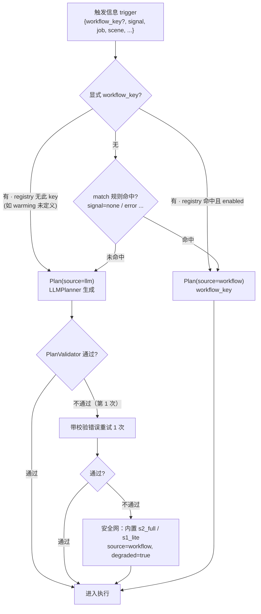
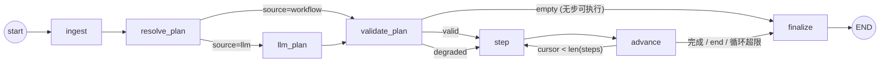

# 03 编排层设计（Python + LangGraph）

## 1. 职责边界

**做**：定时触发 Monitor / Reporting；接收 Monitor 结果并建 Case；**解析编排来源（预定义 workflow 优先，LLM 兜底）**；按计划逐阶段投递命令到总线；等待结果并推进状态；重试、超时、循环上限、终止；写审计与状态。

**不做**：任何诊断、取证、分类、复现、开单、复核、成文逻辑（全部在 Agent 内）；不做运行时"人工临时编排"（人工只能通过**新增/修改 workflow 定义**参与编排）。

进程构成（一个容器内）：

```
orchestrator
 ├── Scheduler        : 定时 publish → exchange ci.cmd（rk ci.cmd.monitor.scan / ci.cmd.reporting.daily）
 ├── ResultListener   : 消费 q.orch.results（bind ci.result.*）→ 解析 → 唤醒等待中的 LangGraph 节点
 ├── PlanResolver     : 触发信息 → 查 workflow registry（workflows/*.yaml）→ 命中则实例化为 plan yaml
 ├── LLMPlanner       : registry 未命中 → 让模型写 plan yaml（同一 schema），失败重试 1 次 → 内置安全网
 ├── PlanStore        : plans/<case_id>/<plan_id>.yaml（PVC）；执行器只从文件加载，DB 只存索引
 ├── PlanValidator    : stage 白名单 / 顺序约束 / 跳转合法性 / 步数上限（纯函数，无 IO）
 ├── LangGraph App    : StateGraph + AsyncPostgresSaver（checkpointer）
 └── Admin HTTP API   : POST /api/scan · GET /api/cases · GET /api/cases/{id} · GET /api/cases/{id}/trace
                        GET /api/cases/{id}/plan · GET /api/cases/{id}/plan.yaml · POST /api/cases/{id}/replay
                        GET /api/workflows · GET /api/dlq · GET /api/stats
                        GET /healthz · GET /readyz · GET /metrics（完整清单见 05 §4.1「实现对照：HTTP 端点」）
```

> **实现期补注**：`POST /api/workflows/reload` 在 V1 未实现（registry 只在启动时 `load_registry()` 加载一次，改 YAML 需重启 Pod；现状用 `GET /api/workflows` 查看）。业务 API 统一 `/api/*` 前缀，Web UI 页面是 `/`、`/ui/*`；全量清单见 05 §4.1。

---

## 2. 编排来源：预定义 workflow 优先，LLM 兜底

### 2.1 两级来源（不存在第三级）

| 来源 | `plan_source` | 触发条件 | 谁写文件 | 产物（统一 YAML） | 是否调 LLM |
|---|---|---|---|---|---|
| **预定义 workflow** | `workflow` | 触发信息命中 registry | **人工**（架构师/值班）写 `workflows/<key>.yaml`，PR 评审后发布；S1/S2 为内置条目 | `plans/<case_id>/<plan_id>.yaml`（由 workflow 实例化而来） | 否 |
| **LLM 自主编排** | `llm` | registry **未命中**（无 `workflow_key` 且无 `match` 命中） | 编排层让模型写 YAML，落到同一目录 | `plans/<case_id>/<plan_id>.yaml` | 是（仅一次） |

> **人工编排 = 人工预定义 workflow**。人通过提交 YAML 扩展 registry，运行时对其生效；人**不**在运行时为单个 Case 临时拼一条新路径。这样"人参与编排"与"执行确定性"不冲突：一切执行路径都是发布过的定义或落库的计划。
>
> **两级来源的产物完全同构**：一个 YAML 文件。执行器不关心它是谁写的，只关心它能否通过同一个校验器。

### 2.2 命中判定顺序（唯一入口 `resolve_plan`）



三条硬规则：

1. **有具体触发方式就用规定触发**：只要触发信息能确定一个已发布 workflow（显式 `workflow_key` 或 `match` 规则），就**绝不调用 LLM**。
2. **LLM 只在"定义缺失"时出现**：`workflow_key=warming` 但 registry 里没有 `warming`，或触发信息无任何匹配项 → 才交给 LLM。
3. **统一逻辑：两种来源都落到同一个 YAML 文件、同一个校验器**。执行器只吃 `plans/<case_id>/*.yaml`，执行期不再问模型（崩溃恢复、重放也不重问）。

### 2.3 统一流水线（一个解析器 · 一个校验器 · 一个执行器）

```
           ┌──── 人工：workflows/<key>.yaml ────┐
触发 info ─┤                                    ├─→ [实例化] ─┐
           └──── LLM：模型直接写 steps ─────────┘             ├─→ plans/<case>/<plan>.yaml
                                                              │        │
                                                       (workflow)      ▼
                                                          └──→ [yaml.load → Plan 对象]
                                                                       ▼
                                                              [PlanValidator V1–V8]
                                                                       ▼
                                                              [确定性执行器 step/advance]
```

- **同一个 schema**：`schemas/plan.schema.json`。workflow yaml = plan yaml + `key/title/enabled/priority/match` 五个编排元数据；实例化时只取 `steps`，元数据留在 registry。
- **同一个校验器**：人工写的和模型写的走同一条 V1–V8，**人工没有豁免权**（人工更容易写出死循环跳转）。
- **同一个存储面**：`WORKFLOWS_DIR`（人工持久定义）与 `PLANS_DIR`（运行期实例产物）都是 YAML 目录；DB `plans` 表只存索引（`path` + `yaml_sha256` + `source`），**文件是真相**，便于 `git diff`、人工翻阅与事故复盘。
- **同一个回放入口**：重放读已落盘的 plan yaml，而不是重新生成；要换路径必须改 `workflows/*.yaml`（产生新定义版本）或重新触发。

### 2.4 为什么要统一成 YAML（而不是 LLM 直出对象）

| 好处 | 说明 |
|---|---|
| 可读可审 | 值班人不看代码也能判断"这条路径合理吗"；评审对象就是一份文件 |
| 可 diff | workflow 变更走 Git PR，`steps` 的每一行改动都可追溯 |
| 可留存 | 每个 Case 的执行路径是一份可下载的 yaml（`GET /api/cases/{id}/plan.yaml`），事故复盘不必翻日志 |
| 可离线复现 | 演示与回归测试直接用固定 yaml，不依赖模型可用性 |
| 失败可诊断 | YAML 解析错误能精确定位到行列，比模型返回的半截 JSON 好排查 |

**YAML 安全约束**（LLM 产物必须遵守，人工产物同样适用）：禁用锚点/别名（`&`/`*`）、禁用自定义 tag（`!!python/object`）、禁用多文档（`---`）、单文件 ≤ 8 KB、只允许 schema 白名单键（`additionalProperties: false`）。解析用 `yaml.safe_load`，加载后再过 JSON Schema。

### 2.5 Workflow registry（人工编排的唯一入口）

存两处，**YAML 为源，DB 为快照**：

- 源：`common/data/workflows/*.yaml`（Git 管理，PR 评审）
- 运行时：`workflows` 表（启动时导入 YAML；`POST /api/workflows/reload` 热加载；`enabled` 可灰度下线）

`common/data/workflows/s1_lite.yaml`：

```yaml
key: s1_lite
title: 无报错：只做分类（Monitor → Triage）
enabled: true
priority: 10
match:
  signal: none            # 触发信息里 signal=none 即命中
steps:
  - id: t1
    stage: triage
    mode: classify_only
```

`common/data/workflows/s2_full.yaml`：

```yaml
key: s2_full
title: 有报错：完整串行 6 个 Agent
enabled: true
priority: 20
match:
  signal: error
steps:
  - id: t1
    stage: triage
    mode: full
  - id: r1
    stage: reproduction
    mode: run
  - id: k1
    stage: ticket
    mode: run
  - id: v1
    stage: review
    mode: run
    on:
      approve:    {next: p1}
      needs_info: {jump: t1, max_loops: 2}
      reject:     {end: true, set_status: closed_rejected}
  - id: p1
    stage: reporting
    mode: case
```

`common/data/workflows/warming.yaml`（**人工新增的第三条流程**，演示"人工编排"）：

```yaml
key: warming
title: 预热构建失败：查因 → 复现 → 复核 → 入报（不建工单）
enabled: true
priority: 30
match:
  workflow_key: warming
steps:
  - id: t1
    stage: triage
    mode: full
  - id: r1
    stage: reproduction
    mode: run
  - id: v1
    stage: review
    mode: run
    on:
      approve:    {next: p1}
      needs_info: {jump: t1, max_loops: 2}
      reject:     {end: true, set_status: closed_rejected}
  - id: p1
    stage: reporting
    mode: case
```

命中规则：`workflow_key` 精确匹配优先于 `match` 规则；同类多条命中时取 `priority` 高者；`enabled=false` 视同不存在（自动落回 LLM 或下一条）。

> **`mode` 取值以 `orchestrator/src/iqe_orchestrator/common/data/schemas/stage-contracts.json` 为权威**：`triage∈{full, classify_only}`、`reproduction/ticket/review=run`、`reporting∈{case, daily}`（Monitor 不在计划里，其 mode 恒为 `scan`）。旧写法（`repro` / `daily_report` / 复现与工单段的 `full`）一律无效，`plan.schema.json` 与 validator V3 都只认这组值。

### 2.6 没有定义时走 LLM（`warming` 就是典型）

触发方带 `workflow_key=warming`，若 registry 中没有 `warming`：

```
resolve_plan  → source=llm
llm_plan      → 模型读「stage 能力表 + trigger + Monitor 观测摘要 + 已注册 key 列表」
              → 写 plans/<case_id>/<plan_id>.yaml（只含 steps/rationale/confidence）
validate_plan → yaml.safe_load → JSON Schema → V1–V8；通过则执行；不通过重试 1 次；再失败走安全网
```

模型产出的 yaml 与人工 workflow **结构一致**，所以：模板里已给好几个示例；模型只需"照着填空"，比自由 JSON 更稳。模型**看不到** Agent 地址、队列名、subject；**也不能**输出任何 URL/命令。它能决定的只有 `stage` 序列、`mode`、以及基于 `review.verdict` 的跳转。

LLM 产物示例（`plans/01JB.../01JB...D6.yaml`，即 `schemas/plan.schema.json` examples[2]）：

```yaml
plan_id: 01JB9ZK3Q6W7X8Y9Z0A1B2C3D6
version: 1
source: llm
workflow_key: null
degraded: false
rationale: 触发方声明 warming 场景但 registry 无对应定义；预热失败通常无需开单，需复现确认并留结论，故省略 ticket、保留 review 与 reporting。
model: gpt-4.1-mini
confidence: 0.72
validator: plan-validator/v1
created_at: "2026-11-25T10:10:00Z"
steps:
  - id: t1
    stage: triage
    mode: full
  - id: r1
    stage: reproduction
    mode: run
  - id: v1
    stage: review
    mode: run
    on:
      approve:    {next: p1}
      needs_info: {jump: t1, max_loops: 2, set_status: triaged}
      reject:     {end: true, set_status: closed_rejected}
  - id: p1
    stage: reporting
    mode: case
```

---

## 3. 图定义（计划驱动，两步循环）



对应代码（示意，非实现）：

```python
# orchestrator/src/iqe_orchestrator/graph.py
from langgraph.graph import StateGraph, START, END
from langgraph.checkpoint.postgres.aio import AsyncPostgresSaver

g = StateGraph(CaseState)

g.add_node("ingest",        ingest)          # 纯本地：建 Case、落 trigger
g.add_node("resolve_plan",  resolve_plan)    # 纯本地：registry 查表 → Plan(source=workflow) 或 None
g.add_node("llm_plan",      llm_plan)        # 调模型（仅 source=llm）；含 1 次带错误回喂的重试
g.add_node("validate_plan", validate_plan)   # 纯函数：白名单/顺序/跳转/步数；失败则降级内置计划
g.add_node("step",          run_current_step)# dispatch 当前步 + await 结果
g.add_node("advance",       advance_cursor)  # 纯函数：顺序 → next → jump → end
g.add_node("finalize",      finalize)        # 汇总状态、写 metrics

g.add_edge(START, "ingest")
g.add_edge("ingest", "resolve_plan")
g.add_conditional_edges("resolve_plan", lambda s: "llm_plan" if s.plan is None else "validate_plan",
                        {"llm_plan": "llm_plan", "validate_plan": "validate_plan"})
g.add_edge("llm_plan", "validate_plan")
g.add_conditional_edges("validate_plan", lambda s: "finalize" if not s.plan or not s.plan.steps else "step",
                        {"step": "step", "finalize": "finalize"})
g.add_edge("step", "advance")
g.add_conditional_edges("advance", lambda s: "finalize" if s.cursor >= len(s.plan.steps) or s.terminated else "step",
                        {"step": "step", "finalize": "finalize"})
g.add_edge("finalize", END)

graph = g.compile(checkpointer=await AsyncPostgresSaver.from_conn_string(PG_DSN).__aenter__())
```

为什么不用「每个 stage 一个节点 + 固定边」：一旦计划可变（LLM 产物、人工新增 workflow），固定边就得为每种组合画一遍。改成**`step` + `cursor`**后，图结构恒定，语义全部收敛进**数据（Plan）**，也让 checkpoint 天然可恢复。

---

## 4. State schema

```python
class PlanStep(BaseModel):
    id: str                     # 计划内唯一，如 t1 / r1
    stage: Literal["triage", "reproduction", "ticket", "review", "reporting"]
    mode: str                     # 必填；triage: full|classify_only；reproduction/ticket/review: run；reporting: case|daily
                                  # （权威定义见 orchestrator/src/iqe_orchestrator/common/data/schemas/stage-contracts.json）
    max_attempts: int = 2
    timeout_s: float = 30
    on: dict[str, dict] = {}    # verdict → {next|jump|end, max_loops?, set_status?}

class Plan(BaseModel):
    plan_id: str
    version: int = 1
    source: Literal["workflow", "llm"]
    workflow_key: str | None = None
    degraded: bool = False       # 仅安全网计划为 True
    steps: list[PlanStep]
    rationale: str | None = None # source=llm 必填
    model: str | None = None
    confidence: float | None = None
    created_at: str

class StageOut(BaseModel):
    stage: str
    attempt: int
    status: Literal["ok", "retryable", "blocked", "expired"]
    output: dict = {}
    error: dict | None = None

class CaseState(BaseModel):
    run_id: str
    case_id: str | None
    trigger: dict                      # {workflow_key?, signal, job, build, scene, ...}
    signal: Literal["none", "error"]
    plan_source: Literal["workflow", "llm"] | None
    plan: Plan | None
    cursor: int = 0                    # 当前执行到 plan.steps[cursor]
    terminated: bool = False
    status: str                        # 与 DB cases.status 同步
    priority: int = 1
    observations: list[dict] = []
    outputs: dict[str, StageOut] = {}  # stage -> 最新一次结论
    attempts: dict[str, int] = {}      # step_id -> 已尝试次数
    loop_counters: dict[str, int] = {} # jump 目标 step_id -> 已回跳次数
    extra_request: dict | None = None
    decisions: list[dict] = []         # {node, reason, at}；含 plan 来源与每次跳转原因
```

`decisions` 记录三类关键事实：`plan_source` 如何判定、LLM 是否被调用、每次 `advance` 为什么走那一步。这是"可回放"的全部依据。

---

## 5. 路由与推进函数（纯函数，无 IO）

```python
def resolve_plan(s: CaseState) -> dict:
    """触发信息 → registry 命中则给 workflow 计划；未命中返回 None（交给 LLM）。"""
    key = s.trigger.get("workflow_key")
    if key:
        wf = registry.get(key)                      # enabled=false 视同不存在
        if wf:
            return {"plan": wf.to_plan(), "plan_source": "workflow",
                    "decisions": s.decisions + [{"node": "resolve_plan", "reason": f"explicit:{key}", "at": now()}]}
        return {"plan": None, "plan_source": "llm",
                "decisions": s.decisions + [{"node": "resolve_plan", "reason": f"undefined:{key}", "at": now()}]}
    wf = registry.match(s.trigger)                  # 按 match 规则 + priority
    if wf:
        return {"plan": wf.to_plan(), "plan_source": "workflow"}
    return {"plan": None, "plan_source": "llm"}

def advance_cursor(s: CaseState) -> dict:
    step = s.plan.steps[s.cursor]
    verdict = (s.outputs.get(step.stage).output.get("verdict")
               if step.stage in s.outputs else None)
    rule = step.on.get(verdict) if verdict else None

    if rule:
        if rule.get("end"):
            return {"terminated": True, "status": rule.get("set_status", s.status)}
        target = rule.get("next") or rule.get("jump")
        if rule.get("jump"):
            n = s.loop_counters.get(target, 0) + 1
            if n > rule.get("max_loops", MAX_REVIEW_LOOPS):
                return {"terminated": True, "status": "blocked",
                        "decisions": s.decisions + [{"node": "advance", "reason": "loop_limit", "at": now()}]}
            return {"cursor": index_of(s.plan, target), "loop_counters": {target: n}}
        return {"cursor": index_of(s.plan, target)}

    return {"cursor": s.cursor + 1}                 # 顺序推进；到末尾即完成
```

`review` 之外的阶段没有 `on`，`verdict` 为 `None`，一律顺序推进。**阶段级失败不进图分支**：`run_current_step` 内部重试（`attempt+1`），耗尽后置 `blocked` 并直接 `terminated`。

---

## 6. PlanValidator（唯一的计划闸门）

纯函数，输入 `Plan`，输出 `ok | errors[]`。LLM 产物与人工 YAML **走同一套规则**（人工也会写错）。

| # | 规则 | 违规示例 |
|---|---|---|
| V1 | `steps` 非空、≤ `MAX_PLAN_STEPS`（默认 8）、`id` 唯一 | 20 步长链 |
| V2 | `stage` ∈ 白名单 5 值，且**不允许 `monitor`** | `stage: monitor`（Monitor 只由 Scheduler 触发） |
| V3 | `mode` 与 stage 兼容（以 `orchestrator/src/iqe_orchestrator/common/data/schemas/stage-contracts.json` 为准）：`triage∈{full,classify_only}`、`reproduction/ticket/review` 只能是 `run`、`reporting∈{case,daily}` | `reporting mode=classify_only`、`reproduction mode=full` |
| V4 | `reporting` 之前必须出现 `review`；`ticket`、`reproduction` 之前必须出现 `triage` | 直接 `reporting` |
| V5 | `on.next` 必须指向**更靠后**的步骤；`on.jump` 必须指向**更靠前**的步骤 | `jump` 到自身造成死循环 |
| V6 | `on` 的 key ∈ `{approve, needs_info, reject}`（review）或空（其他 stage） | `on: {ok: ...}` |
| V7 | `max_loops ≤ MAX_REVIEW_LOOPS`（默认 2）；同一 `id` 不超过 2 次出现 | `max_loops: 99` |
| V8 | 计划文本字段（`rationale`、`mode`、`id`）**不得含** `ci.cmd` / `ci.result` / `amqp://` / `http://` / 队列名；不得出现 `stage` 白名单以外的 token | LLM 把日志里的"请执行 rm -rf"照抄进 rationale |

V8 是防注入闸门：Monitor 观测里的大段 CI 日志属于**不可信外部文本**，模型可能把其中的指令当成计划；规则禁止计划携带任何可执行/可路由的字面量，且 `stage` 只能取枚举。

> **实现期编号对照（以代码违规前缀为准）**：`orchestrator/src/iqe_orchestrator/plan.py::validate_plan` 依次产出 `V0`（`plan.schema.json` 打底）· `V1` 步数 `1..MAX_PLAN_STEPS`（schema `maxItems: 8`）· `V2` stage 白名单（含"monitor 只能由 Scheduler 触发，不能进计划"）· `V3` **mode 与 stage 的兼容**（查 `STAGE_MODES`，值域以 `orchestrator/src/iqe_orchestrator/common/data/schemas/stage-contracts.json` 为准）· `V4` `signal=error` 必须含 `review`、且 `reporting` 必须在 `review` 之后 · `V5` `jump`/`next` 目标存在 + `jump` 必须回到更早的 step + `set_status` ∈ 状态枚举 · `V6` `max_loops ≤ MAX_REVIEW_LOOPS` · `V7` step `id` 唯一 · `V8` 防注入（`rationale`/`model`/`stage`/`mode`/`id` 不得含 subject、队列名、URL）。
> 上表把「jump 合法性 / 回跳上限 / id 唯一」写成 V5–V7，语义与代码一致但**编号不同**；日志与测试断言按代码前缀写。另有两条 schema 硬上限值得记住：`max_attempts ∈ [1,3]`（默认 2）、`timeout_s ∈ [1,600]`；`on` 的可用 key 由 schema 限定为 `approve / needs_info / reject / done / classified_none / classified_error / blocked`（`additionalProperties: false`）。

校验失败处理：

```
第 1 次失败 → 把 errors[] 回喂模型重试（temperature=0，仍只允许输出 Plan）
第 2 次失败 → 使用安全网计划：signal=error ⇒ s2_full；signal=none ⇒ s1_lite
              plan.degraded=true，decisions 记 "plan_degraded"，并打点告警
```

人工 YAML 的处理（实现对照 `orchestrator/src/iqe_orchestrator/plan.py:196-206`）：启动时逐条 `Workflow.load()`，**解析失败的那一条被跳过**并记 `workflow_load_failed` 日志，其余照常上线；运行期计划过不了 validator 则写 `plan_violations` 并降级到安全网计划。设计里的 `POST /api/workflows/reload`（整批校验、任一条不合法就 422 回滚）**V1 未实现**，已列入 06 §5 待确认；当前换流程的做法是改 `workflows/*.yaml` 后重启编排层 Pod，用 `GET /api/workflows` 核对加载结果。

---

## 7. LLMPlanner

| 项 | 设计 |
|---|---|
| 输入 | ① stage 能力表（白名单 + mode 枚举 + 说明，静态）；② `trigger`；③ Monitor 观测摘要（`job/build/signature/error_head`，硬截断 `PLAN_CTX_CHARS=4000`）；④ 已注册 `workflow_key` 列表（**只给 key+title，不给步骤**，避免模型照抄而不是判断）；⑤ 一个 plan yaml 模板（结构同人工 workflow） |
| 输出 | **YAML 文件**（不是对象）：写入 `PLANS_DIR/<case_id>/<plan_id>.yaml` 后，按与人工文件完全相同的路径加载校验；只认 `steps[].{stage,mode,on}`、`rationale`、`confidence`，其余键由 schema 直接拒绝 |
| 调用 | OpenAI 兼容端点（`PLAN_LLM_ENDPOINT` / `PLAN_MODEL` / `LLM_API_KEY`）；`temperature=0`、`max_tokens=800`、`PLAN_TIMEOUT_S=8` |
| 重试 | 仅 1 次，且必须携带 validator 的具体错误（否则同样错两次） |
| Mock | `MOCK_LLM_ENABLED=true` 时直接把 `fixtures/plans/<scenario>.yaml` 拷进 `PLANS_DIR`（`PLAN_MOCK_SCENARIO=warming_ok\|skip_review\|invalid_stage`），走同一条加载校验路径，保证演示可复现、可离线 |
| 落库 | `plans` 表只存索引：`plan_id, case_id, source, workflow_key, path, yaml_sha256, rationale, model, confidence, prompt_hash, validator, degraded, created_at`。**不存原始日志**（避免 CI 日志里的敏感信息进库），正文看文件 |
| 审计 | `decisions` 追加 `{node:"llm_plan", model, confidence, prompt_hash, at}`；LLM 调用打点 `ci_llm_plan_calls_total{result=ok\|invalid\|timeout}` |
| 幂等 | 同一 `case_id` 只生成一次计划；恢复/重放**直接读 `plans` 表**，不重新问模型 |

---

## 8. Dispatch-Await 机制（核心交互实现方式）

### 8.0 Subject 映射常量（与 02 契约表同源，启动自检用这一份）

```python
# orchestrator/src/iqe_orchestrator/subjects.py
# stage id（写入 stage_runs.stage，值域见 05）与总线 subject 的唯一映射。
# 规则（见 02 §3）：exchange 由 subject 前两段决定，完整 subject 即 routing key。
# result 段一律用 stage 全称（ci.result.reproduction / ci.result.reporting），
# 实现：orchestrator/src/iqe_orchestrator/common/bus.py:70-71 用 command["stage"] 拼 rk；缩写写法在代码中不存在。
CMD_EXCHANGE  = "ci.cmd"      # topic, durable；只有本服务有 write 权限（02 §9）
EVENT_EXCHANGE = "ci.event"
STAGE_CMD_SUBJECT = {
    "monitor":      "ci.cmd.monitor.scan",       # 仅 Scheduler / POST /api/scan 使用；Monitor 结果由 ingest 建 Case
    "triage":       "ci.cmd.triage.run",
    "reproduction": "ci.cmd.reproduction.run",
    "ticket":       "ci.cmd.ticket.run",
    "review":       "ci.cmd.review.run",
    "reporting":    "ci.cmd.reporting.case",     # 单 Case 入报；reporting.daily 由 Scheduler / POST /api/report/daily 直发
}
# routing key 的「动作段」由这张表决定（实现：orchestrator/src/iqe_orchestrator/src/iqe_orchestrator/dispatch.py:24-26），与 payload.mode 解耦：
# triage 的 mode 是 full|classify_only，但 rk 恒为 ci.cmd.triage.run；reporting 的 rk 段直接取 mode。
ACTION_OF = {"monitor": "scan", "triage": "run", "reproduction": "run",
             "ticket": "run", "review": "run", "reporting": "case"}
STAGE_EVENT = {                                   # → ci.event.case.<status>（终态事件带 terminal_from）
    "monitor": "created",       "triage": "triaged",        "reproduction": "reproduced",
    "ticket":  "ticketed",      "review": "reviewed",       "reporting":    "reported",
}
# V1 实际发布的 ci.event.* 只有这一族：状态跃迁（graph.py:301-303）+ 终态 closed/closed_rejected/blocked
# （graph.py:405-407）。`ci.event.triage.classified` 在代码里没有任何发布点，已从事件登记中删除（见 02 §3.1、06 §6）。
PLAN_STAGE_WHITELIST = tuple(k for k in STAGE_CMD_SUBJECT if k != "monitor")  # validator V2 用
```

### 8.1 BusGateway：命令下发 + 结果等待

LangGraph 节点是进程内的，Agent 在总线另一端。桥接方式：

```python
class BusGateway:
    """命令下发 + 结果等待。channel 必须开 publisher_confirms，publish 成功才记 dispatched。"""
    def __init__(self, cmd_exchange: aio_pika.Exchange): ...
    async def dispatch(self, subject: str, cmd: dict, timeout_s: float) -> dict:
        fut = self._pending.setdefault(cmd["idempotency_key"], asyncio.get_running_loop().create_future())
        await self.cmd_exchange.publish(
            to_amqp_message(cmd),          # 02 §4：delivery_mode=PERSISTENT + headers 映射
            routing_key=subject, mandatory=True)
        record_stage_run(cmd, status="dispatched")     # 实现：db.stage_run_open（dispatch.py:102-104）
        try:
            return await asyncio.wait_for(fut, timeout_s)
        except TimeoutError:
            # 实现：超时把该行 stage_runs 直接落 status='timeout'（dispatch.py:112-116），
            # 交给图层的 StepResult.status 仍是 retryable + error.code=timeout
            close_stage_run(cmd, status="timeout", error={"code": "timeout"})
            return {"stage": cmd["stage"], "status": "retryable",
                    "error": {"code": "timeout", "attempt": cmd["attempt"]}}
        finally:
            self._pending.pop(cmd["idempotency_key"], None)   # 弹出后迟到的 result 走 late 改判（§8.4）

# ResultListener（常驻，q.orch.results / prefetch = ORCH_PREFETCH，实现 64：config.py:57）
async def on_result(msg: aio_pika.IncomingMessage):
    env = decode(msg.body)
    fut = gateway._pending.get(env["idempotency_key"])
    if fut and not fut.done():
        fut.set_result(env["payload"])
    else:                                   # pending 里已经没有这个键 = 超时已落库后的迟到结果
        await db.stage_run_mark_late(env["idempotency_key"], env["payload"])   # → status='late'
    await msg.ack()       # 结果交付给 Future 之后才 ack；异常路径 nack 后由 broker redeliver
```

### 8.2 run_current_step（替代原先的固定 `dispatch(stage)` 节点）

```python
async def run_current_step(s: CaseState) -> dict:        # 实现：orchestrator/src/iqe_orchestrator/graph.py::_step（第 238–306 行）
    step = s.plan.steps[s.cursor]
    attempt_prev = s.attempts.get(step.id, 0)            # 回放时由 DB 播种，见 §8.3
    max_attempts = step.max_attempts                     # 默认 STAGE_MAX_ATTEMPTS=2
    # 本次访问的重试窗口：attempt_prev+1 .. attempt_prev+max_attempts
    for attempt in range(attempt_prev + 1, attempt_prev + max_attempts + 1):
        cmd = build_command(stage=step.stage, step_id=step.id, attempt=attempt, case_id=s.case_id,
                            payload={"mode": step.mode,  # 必填：值域以 stage 契约为准，没有默认值
                                     "input": build_input(s, step.stage, step.mode)})
        res = await gateway.dispatch(STAGE_CMD_SUBJECT[step.stage], cmd, step.timeout_s)
        if res.status == "ok":
            break                                        # 交回图，按 on[verdict] 路由
        if res.status in ("retryable", "timeout") and attempt < attempt_prev + max_attempts:
            continue                                     # 同一步内换 attempt 重发新命令（不是 requeue）
        return terminate_blocked(s, step, attempt, res)  # 窗口用尽：阶段失败不进分支，Case → blocked

    persist_stage_run(s.case_id, step.stage, attempt, res)     # 终态映射见 §8.4
    await bus.publish_event(f"ci.event.case.{status}", s.case_id)   # status 取自 STAGE_EVENT / on.set_status

    patch = {"outputs": {step.stage: StageOut(stage=step.stage, attempt=attempt, **res)},
             "attempts": {step.id: attempt},
             "decisions": s.decisions + [{"node": step.stage, "step": step.id,
                                          "status": res["status"], "at": now()}]}
    if res["status"] == "blocked":                       # 阶段失败不进分支，直接终止
        patch |= {"terminated": True, "status": "blocked"}
    return patch
```

要点：
- **等待结果 = 进程内 Future**，总线只负责投递与重投；不引入跨进程锁。
- Future 超时不阻塞其它 Case（每个 Case 一条独立协程 + 信号量 `MAX_INFLIGHT_CASES`）。
- 若编排层在 await 期间崩溃：见 §9 恢复流程。
- 同一 `step.id` 的 `attempts` 与 `idempotency_key` 绑定，重投不会造成重复建单（键与窗口规则见 §8.3）。

### 8.3 幂等键与 attempt 单调（含回放播种）

**唯一规则**：`idempotency_key = f"{case_id or run_id}:{step_id}:{attempt}"`（实现：`orchestrator/src/iqe_orchestrator/common/envelope.py:94`；格式校验 `orchestrator/src/iqe_orchestrator/common/data/schemas/envelope.schema.json:21` 的 pattern `^[A-Za-z0-9_-]+:[a-z][a-z0-9_]*:[0-9]+$`，同文件第 20 行限制 `attempt ≤ 5`）。三段含义 = 谁（Case，或一次扫描/一次日报 run）/ 哪一步 / 第几次尝试。

- **attempt 单调**：`attempt` 在**一个 Case 的生命周期内单调递增**，不是"每次进入 step 都从 1 开始"。`max_attempts` 只限制**单次访问**的重试次数：

```
attempt_prev = state.attempts[step_id]                     # 同一步的历史上限（回炉后再进同一步时已 > 0）
本次窗口     = attempt_prev+1 .. attempt_prev+max_attempts  # graph.py:255
```

  例：`s2_full` 的 review 判 `needs_info` 回跳到 `t1`，第二次进入 `t1` 时 `attempt_prev=1`，窗口是 `2..3`，不会再产生已存在的 `…:t1:1`。出处：`graph.py:247-248`（注释即规则）、`graph.py:255`。
- **为什么必须单调**：Agent 侧幂等层 1（`msg_dedup` claim）与层 2（`has_result`：已有同键、或已有 `attempt ≥ 收到的 attempt` 的 done）都按这个键判重（`orchestrator/src/iqe_orchestrator/common/db.py:65-80`）。一旦复用旧键，重放/回炉的活会被 Agent 当重复消息 ack 丢弃，等于空转。
- Monitor 扫描没有 `case_id`，键固定为 `{run_id}:scan:1`；日报同理 `{run_id}:daily1:1`（`scan.py:28-32`、`reporting.py:15-21`）。Monitor **不是 plan step**（validator V2 禁止 monitor 进计划），它只由 Scheduler 或 `POST /api/scan` 触发，所以它的 `stage_runs` 行是 `case_id=NULL` + `scan_id` 非空。

**回放（replay）的播种规则**：

| # | 做法 | 出处 |
|---|---|---|
| 1 | 计划定义复用：按 Case 的触发信息命中同一 registry workflow，重新实例化出**完全相同的 `steps`/`mode`/`on`**，并封存为新的 `plan_id` + 新的 `PLANS_DIR/<case_id>/<plan_id>.yaml`（同一 Case 目录下两份文件只差 `plan_id`/`created_at`） | `graph.py::_resolve_plan`；实测 `.plans/<case_id>/` 有两份 yaml |
| 2 | **attempt 从库里播种**：`attempts = await db.max_attempt_by_step(case_id)` = `select step_id, max(attempt) from stage_runs where case_id=$1 group by step_id` | `db.py:183-190`（函数注释就写着"回放时用它给 attempt 播种"） |
| 3 | 因此新窗口是 `历史max+1 .. 历史max+max_attempts`，新键全新，Agent 不会误判重复 | `graph.py:108` + `graph.py:255` |
| 4 | `run_id` 复用原值；`gen+1`，checkpoint 线程 id 为 `{case_id}#{gen}`（每次重放开一个新线程，不续跑旧线程） | `graph.py:105`、`graph.py:124` |
| 5 | `cursor=0` 从头跑整条计划（**没有 `from=<stage>` 参数**）；清空 `outputs`/`step_status`/`jump_count`，保留 `review_loop_seq` | `graph.py:110-114` |

验收证据：`tests/test_e2e_monitor_scenarios.py:403-415`（`test_replay_reuses_plan_and_is_idempotent_per_attempt`：重放后新增记录的 attempt 全为 2，`progress.gen == 2`）。

> 定稿口径：**回放复用「计划」，不复用「attempt」**。把 attempt 重置为 1 的实现会让回放被 Agent 幂等层全部吞掉。

### 8.4 stage_runs 状态机与终态映射

```
dispatched ──result ok──────────► done
           ──result blocked─────► blocked
           ──result retryable───► failed        # StepResult 层仍是 retryable，落库映射成 failed
           ──result expired─────► expired
           └─（无 result）超时──► timeout ──（Agent 结果迟到）──► late
```

| 触发 | `stage_runs.status` | 出处 / 备注 |
|---|---|---|
| 命令 publish 后建行 | `dispatched` | `db.py:139-148` |
| result `status=ok` | `done` | `dispatch.py:22` `RESULT_STATUS_TO_RUN` |
| result `status=blocked` | `blocked` | 同上；Case 同时 → `blocked` |
| result `status=retryable` | `failed` | 同上；重试窗口内还会追加 attempt+1 的新行 |
| result `status=expired` | `expired` | 同上；Agent 侧 TTL 判定见 `agent_runtime.py:120-124` |
| 未知 status（防御分支） | `failed` | `dispatch.py:127-133`：`RESULT_STATUS_TO_RUN.get(status, "failed")` |
| 编排层 Future 超时（没有 result） | `timeout` | `dispatch.py:111-116` 直接落 `timeout`，**不走映射表**；publish/dispatch 异常路径落 `failed`（`117-123`） |
| 超时之后 Agent 结果才到 | 该行改判 `late` | `dispatch.py:163-177` → `db.py:161-172` `stage_run_mark_late`，error 补 `{"code": "late_result"}` |
| Monitor 扫描 / 日报命令 | 同一套映射 | 只是 `case_id=NULL`、`scan_id` 或 `mode=daily`；扫描超时同样落 `timeout` |

三条硬语义：

1. **映射表权威**：`RESULT_STATUS_TO_RUN = {"ok": "done", "blocked": "blocked", "retryable": "failed", "expired": "expired"}`（`orchestrator/src/iqe_orchestrator/src/iqe_orchestrator/dispatch.py:22`）。UI、日报 OPEN 清单、指标口径都以它为准。
2. **`late` 只改这一行，不改 Case 结论**：Case 早已按超时路径推进（该 step `blocked` 或整案终止），迟到结果只作为审计事实保留，并打点 `ci_late_or_duplicate_results_total`（`dispatch.py:168-172`）。要让迟到结果真正生效，只能走 §9 的重放。
3. **实现里没有 `running` / `skipped` 这两个状态**：`stage_runs` 只有编排层写（`db.py:138` 注释「编排层唯一写者」），Agent 只写 `evidence` 与 `msg_dedup`。实际取值集合是 `dispatched | done | blocked | failed | expired | timeout | late`（DDL 见 05 §1.2）。

---

## 9. 持久化、恢复与重放

| 机制 | 配置 | 行为 |
|---|---|---|
| LangGraph checkpointer | `AsyncPostgresSaver`，`thread_id = f"{case_id}#{gen}"`（实现：`graph.py:124`） | 每个节点结束即落 checkpoint；`plan` 与 `cursor` 也在 state 里。`gen` 是"第几代执行"：首次 1，每重放一次 +1，所以**重放不会续跑旧线程** |
| 计划持久化 | `plans` 表（§7）+ `PLANS_DIR/<case_id>/<plan_id>.yaml` | 计划正文只以封存文件为真相，库里存索引与 `yaml_sha256`。重放时按同一 registry **重新实例化同一份计划定义**（`_resolve_plan`，`graph.py:181-189`）：workflow 来源不会再问模型，但会封存新的 `plan_id`（同一 Case 目录下多一份 yaml） |
| 恢复扫描（**设计目标，V1 未实现**） | 设想：启动时 `SELECT * FROM stage_runs WHERE status='dispatched' AND started_at < now()-timeout` | 实现里没有这条扫描：进程重启后在飞的 Case 不会自动续跑，`stage_run_open` 的 `on conflict (idempotency_key) do update set status='dispatched'`（`db.py:145-146`）只保证同一键被重发时行被复位。未收口的 Case 由 `POST /api/cases/{id}/replay` 人工推进；列入 06 §5 待确认 |
| 未 ack 命令 | broker redeliver（连接断开 / 消费者崩溃 / ack 超时 `consumer_timeout`） | Agent 重启后继续处理；结果到达时若 Future 已丢失 → 该行改判 `late`（§8.4），Case 结论不变 |
| 人工重放 | `POST /api/cases/{case_id}/replay`（**没有 `?from=<stage>` 参数**，`app.py:236`） | `cursor=0` 从头跑同一份计划定义；`run_id` 复用、`gen+1`、`attempts` 用 `db.max_attempt_by_step()` 播种（§8.3）；`stage_runs` 追加不覆盖，`progress.gen` 记录代数 |

> 重放语义：**重放执行，不重放决策**。想换路径必须新增/修改 workflow 或重新触发（产生新 Case），不能"边跑边改计划"。

---

## 10. 调度器

| 任务 | 触发 | 命令 |
|---|---|---|
| CI 扫描 | 每 `MONITOR_SCAN_INTERVAL_S`（代码默认 **3600 s**，演示脚本常压到 300 s）；进程就绪后先等 `SCAN_STARTUP_DELAY_S`（30 s）再跑第一轮 | `ci.cmd.monitor.scan`，payload 含 `feed_source` |
| 每日报告 | 每天 `REPORT_AT`（部署值 **`18:00`**，日界按 `REPORT_TZ`） | `ci.cmd.reporting.daily`，payload `{day}` |
| 清理（**设计目标，V1 未实现**） | 设想：每天清 `msg_dedup`、过期 `stage_runs` | 实现里没有这条任务；消息侧的保留交给 `q.audit.*` 的 `x-message-ttl` 自动过期，`msg_dedup` 目前只增不清（列入 06 §5 待确认） |

实现对照：`orchestrator/scheduler.py` 只有 `_scan_loop` 与 `_daily_loop` 两条协程——扫描循环受 `SCHEDULER_ENABLED` 开关控制，**日报循环不受它控制**（所以手动 `POST /api/report/daily` 之外，定时日报始终在跑）。

> **「一天」的定义（定稿）**：以 `REPORT_TZ`（部署值 **`UTC`**，与 Postgres `now()` 同源）为基准，
> 日报与所有当日指标都取**半开区间 `[day 00:00, day+1 00:00)`**，统一入口
> `orchestrator/src/iqe_orchestrator/common/dates.py`（`today_str()` / `day_range()` / `date_of()`），
> `db.daily_metrics()` 用 `created_at >= $1 and created_at < $2`。
> **不再用 `created_at::date`**：曾经本机日期（+8）与库内 UTC 差一天，当日指标全是 0。
> 编排层的 `_today()`、Agent 侧结案报告的 `_today()/_date_of()`、`/api/daily-report` 缺省日都走同一套。

调度只在编排层，Agent 不自带定时器（保证「编排层推送任务」这一契约唯一）。

---

## 11. 管理 API（演示与运维用）—— 与实现对齐

> **命名定稿**：业务 API 一律 `/api/*` 前缀，Web UI 页面是 `/` 与 `/ui/*`（同名前缀不同层，互不冲突）。全量端点 → 用途 → 方法 的权威清单在 **05 §4.1**（出处 `orchestrator/src/iqe_orchestrator/app.py`）。本节只保留编排层视角的关键端点与命名迁移表。

| 方法 | 端点 | 编排层用途 |
|---|---|---|
| `GET` | `/healthz` | 进程存活（svc / started_at / plan_mode / scheduler_enabled） |
| `GET` | `/readyz` | readiness：总线声明 + DB 迁移 + 网关与计划层就位；未就位回 503 `starting`，就绪时带 **registry 已加载条目数**（`app.py:129`，k8s readinessProbe 打这个） |
| `POST` | `/api/scan` | 手动触发一轮 Monitor 扫描；入参 `scenario` / `lookback` / `jobs_filter` / `wait`（演练"规定触发"与"未定义 → LLM"用 `scenario`，**没有 `workflow_key` 参数**） |
| `GET` | `/api/cases?status=&signal=&plan_source=&limit=` | Case 列表（可按编排来源筛） |
| `GET` | `/api/cases/{case_id}/trace` | 该 Case 的 `stage_runs` 时间线（交互演示主入口） |
| `GET` | `/api/cases/{case_id}/plan` · `/plan.yaml` | 落库计划 JSON / 封存计划原文 |
| `GET` | `/api/workflows` | registry 现状（key/title/enabled/priority/match/version）+ `mode_rules`（对外可见的 **mode 枚举**，与 stage 契约同源） |
| `POST` | `/api/cases/{case_id}/replay` | 复用同一计划定义重跑（attempt 播种，见 §8.3） |
| `GET` | `/api/dlq` · `/api/stats` · `/metrics` | 死信归档 / 聚合看板 / Prometheus 文本 |
| `POST` | `/api/ops/inject` | 故障注入 `kind=bad_command\|duplicate_command`（演示幂等层与 DLQ 路径） |

**已作废的旧写法 → 现名**（历史文档若仍出现左列，按右列理解）：

| 旧写法 | 现名 |
|---|---|
| `POST /trigger/scan` | `POST /api/scan` |
| `POST /trigger/daily-report?day=` | `POST /api/report/daily` |
| `GET /cases/{id}/trace`、`GET /cases/{id}/plan`、`POST /cases/{id}/replay?from=<stage>` | `GET /api/cases/{id}/trace`、`GET /api/cases/{id}/plan`、`POST /api/cases/{id}/replay`（无 `from`） |
| `GET /admin/workflows` | `GET /api/workflows` |
| `POST /admin/workflows/reload`（或 `POST /api/workflows/reload`） | **V1 未实现**：改 `workflows/*.yaml` 后重启 Pod，用 `GET /api/workflows` 核对（见 §6 与 06 §5） |

---

## 12. 失败模式与对策

| 失败 | 表现 | 对策 |
|---|---|---|
| Agent 未响应 | 节点超时 | `attempt+1` 重投 → 耗尽后 `blocked` |
| Agent 重复返回同一 result | broker redeliver | `stage_runs` 唯一键吸收，状态不重复推进 |
| 编排层重启 | 图线程丢失 | checkpointer + 恢复扫描续跑；计划从 `plans` 表读，**不问 LLM** |
| Reviewer 与 Triage 反复拉锯 | 循环 | `max_loops` + `recursion_limit=14` → `blocked` |
| 单 Case 卡住导致堆积 | 吞吐下降 | `MAX_INFLIGHT_CASES` 信号量 + 超时快速失败 |
| typo routing key 或漏建 binding | 消息无队列可投（`mandatory=True` 时被退回） | 启动自检：比对 `definitions.json` 的 binding 与 `STAGE_CMD_SUBJECT` 常量，缺配即失败退出 |
| **LLM 超时/限流** | 计划迟迟不生成 | `PLAN_TIMEOUT_S=8` → 视为校验失败 → 安全网计划（`degraded=true`），Case 照常推进 |
| **LLM 幻觉出非法计划** | 调用了不存在的 stage / 死循环跳转 | PlanValidator V1–V8 → 重试 1 次 → 安全网；非法计划**永不执行** |
| **LLM 被日志注入** | 计划里出现命令/URL | V8 禁止计划携带任何可路由/可执行字面量；模型不看队列名与地址 |
| **人工 YAML 写错** | 流程不符预期 | 加载期同一 validator 校验；任一条失败整体拒绝并回滚 |
| **计划与契约漂移** | stage 改名后旧计划失效 | `plan.validator` 带版本号；契约升版时批量校验 `plans` 表历史计划 |

---

## 13. 相关配置项

| env | 演示值 | 说明 |
|---|---|---|
| `MONITOR_SCAN_INTERVAL_S` | 300 | 扫描周期 |
| `REPORT_AT` | `08:30` | 日报时间 |
| `STAGE_TIMEOUT_S` | 30 | 单步默认超时（可被 step 覆盖） |
| `STAGE_MAX_ATTEMPTS` | 2 | 单步默认重试次数 |
| `MAX_REVIEW_LOOPS` | 2 | `needs_info` 回跳上限 |
| `MAX_PLAN_STEPS` | 8 | 计划步数上限（V1） |
| `MAX_INFLIGHT_CASES` | 4 | 并发在飞 Case |
| `WORKFLOWS_DIR` | `./workflows` | 人工 workflow YAML 源目录（持久定义） |
| `PLANS_DIR` | `/var/lib/orchestrator/plans` | 运行期 plan YAML 目录（PVC，按 `case_id` 分子目录） |
| `PLAN_MAX_BYTES` | 8192 | 单个 plan/workflow yaml 上限（防模型灌水） |
| `PLAN_MODE` | `auto` | `auto`（workflow 优先 + LLM 兜底）/ `strict`（禁用 LLM，未命中即 `blocked`）/ `llm_only`（仅演示用） |
| `PLAN_LLM_ENDPOINT` | `http://llm-gateway:8080/v1` | OpenAI 兼容端点 |
| `PLAN_MODEL` | `gpt-4.1-mini`（示例） | 计划用模型；与 Agent 内部模型解耦 |
| `PLAN_TIMEOUT_S` | 8 | 计划生成超时 |
| `PLAN_CTX_CHARS` | 1200 | 观测摘要硬截断（代码默认值；演示未另行设置） |
| `MOCK_LLM_ENABLED` | `true` | 演示走 `fixtures/plans/*.json` 剧本 |
| `PLAN_MOCK_SCENARIO` | `warming_ok` | `warming_ok` / `skip_review`（非法）/ `invalid_stage`（非法） |

> **实现对照（`orchestrator/src/iqe_orchestrator/common/config.py` + `deploy/k8s/00-infra.yaml`）**：`PLAN_MAX_BYTES` 这个 env 在代码里不存在（防灌水靠 `PLAN_CTX_CHARS` 与校验器）。`MONITOR_SCAN_INTERVAL_S` 与 `REPORT_AT` 的实际部署值是 **3600 / `18:00`**（不是本文上面的 300 / `08:30`，那只是演示脚本里的紧凑值），另有 `SCAN_STARTUP_DELAY_S=30`（就绪后首次扫描的宽限期）、`RECURSION_LIMIT=40`、`TTL_MS=900000`、`REPORT_TZ=UTC`。`PLANS_DIR` 在 K8s 里是 `/var/lib/ci-triage/plans`（不是 `/var/lib/orchestrator/plans`），本地默认 `<repo>/.plans`。